# 📚 Devolva — App Android de empréstimo de livros


Aplicativo Android para controlar o empréstimo de livros de uma biblioteca, com **duas interfaces separadas**: uma para o **cliente** (quem pega os livros) e outra para o **administrador** (quem gerencia livros, usuários e empréstimos). O app mostra a capa e a descrição de cada livro, calcula multas por atraso e usa autenticação com **JWT**.

> 🎓 Projeto acadêmico.
>
> 🔗 **Este repositório contém apenas o aplicativo.** A API (Node.js + Express + MySQL) está em outro repositório: **[api-projeto-final-java](https://github.com/Sandroluan/api-projeto-final-java)**.

---

## 📑 Sumário

- [Funcionalidades](#-funcionalidades)
- [Telas](#-telas)
- [Tecnologias](#-tecnologias)
- [Como funciona o login](#-como-funciona-o-login)
- [API](#-api)
- [Banco de dados](#-banco-de-dados)
- [Estrutura do projeto](#-estrutura-do-projeto)
- [Como executar](#-como-executar)
- [Problemas comuns](#-problemas-comuns)
- [Autor](#-autor)

---

## ✨ Funcionalidades

### 👤 Cliente
- Ver **os próprios empréstimos**, com capa, autor, prazo e situação (`NO PRAZO`, `ATRASADO`, `ENTREGUE`).
- Acompanhar a **multa acumulada** e a quantidade de livros atrasados.
- Filtrar empréstimos: **Todos**, **Atrasados** ou **Entregues**.
- Navegar pelo **catálogo** de livros, com busca por título ou autor.
- Abrir a **tela de detalhes** do livro (capa grande, autor e descrição).
- **Pegar um livro emprestado** pelo próprio app (prazo de 7 dias).
- Ver o perfil e sair da conta.

### 🛠️ Administrador
- Ver **todos os empréstimos**, com o nome de quem pegou cada livro.
- **Criar empréstimos** para qualquer usuário e **marcar devoluções**.
- **Adicionar, editar e excluir livros**. Ao adicionar, a API busca a capa e a descrição automaticamente no Google Books.
- Listar todos os **usuários** cadastrados.
- Ver o perfil e sair da conta.

---

## 📱 Telas


### Login e cliente

| Login | Início (cliente) | Catálogo | Detalhes do livro |
|:---:|:---:|:---:|:---:|
| 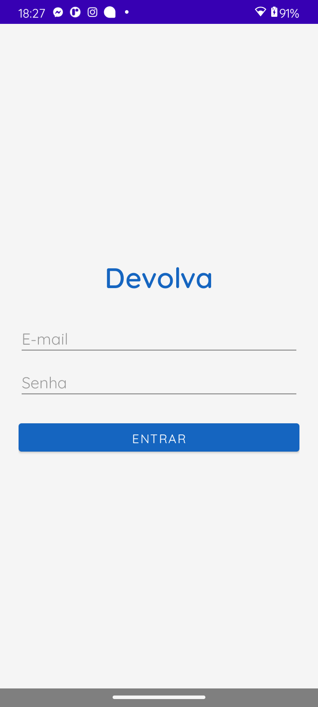 | 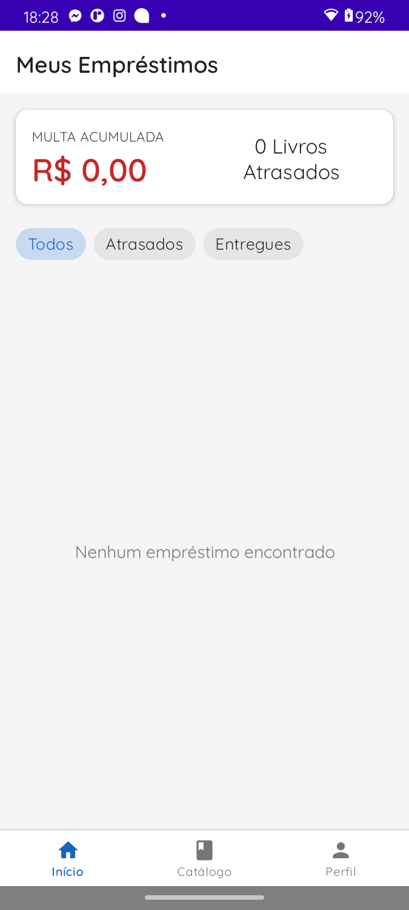 | 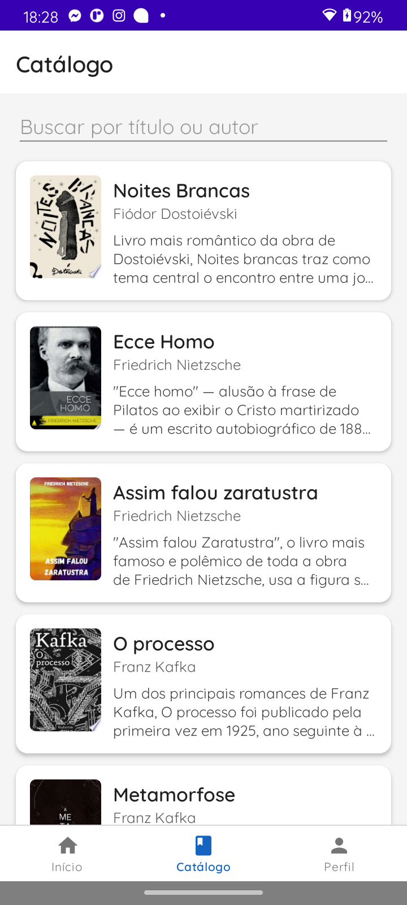 | 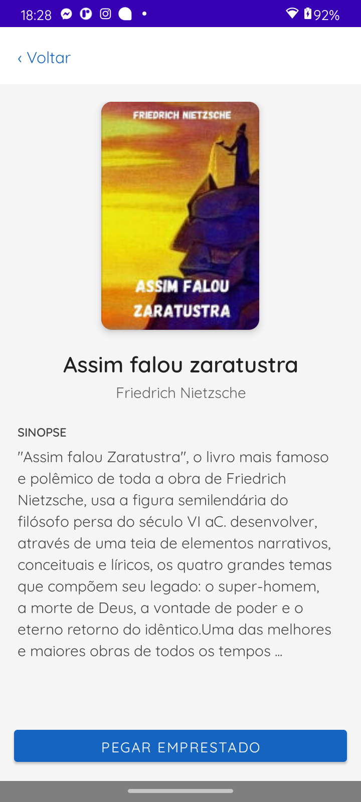 |

### Administrador

| Empréstimos | Livros | Novo/editar livro | Usuários |
|:---:|:---:|:---:|:---:|
| 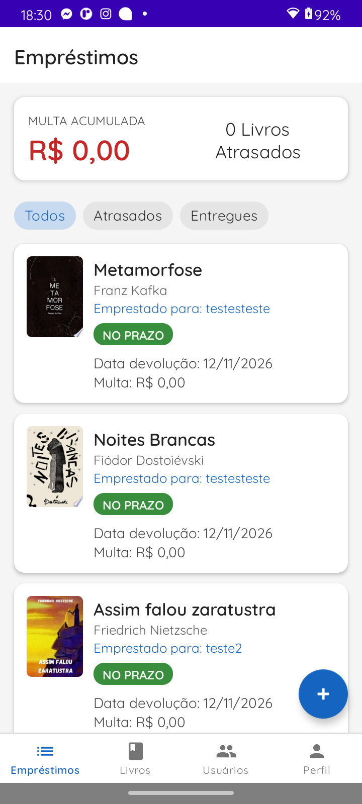 | 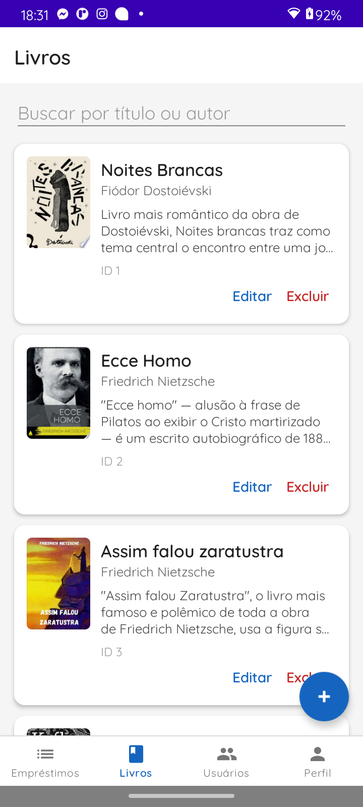 | 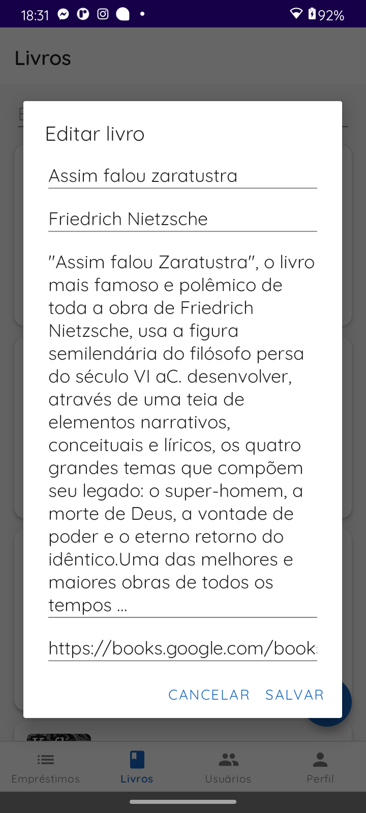 | 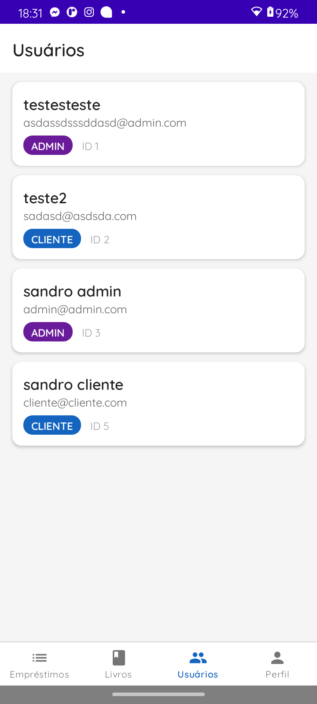 |

---

## 🧰 Tecnologias

| Camada | Tecnologia |
|---|---|
| Linguagem | Java 17 |
| Plataforma | Android (minSdk 24, compileSdk/targetSdk 34) |
| Build | Gradle + Android Gradle Plugin 8.2.0 |
| Interface | Material Components, `BottomNavigationView`, Fragments, RecyclerView |
| Rede | Retrofit 2.9.0, OkHttp, Gson |
| Imagens | Glide 4.16.0 (capas dos livros) |
| Autenticação | JWT (token enviado no header `Authorization: Bearer ...`) |

---

## 🔐 Como funciona o login

O app sempre abre na tela de login. A resposta da API traz o `tipo` do usuário, e é ele que define qual interface será aberta:

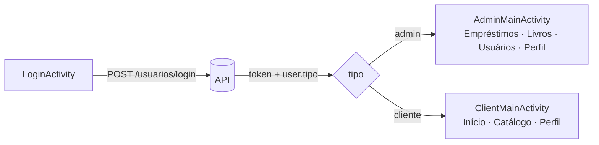

- O token e os dados do usuário ficam salvos em `SharedPreferences` (classe `Session`).
- Um interceptor do OkHttp (`ApiClient`) coloca o token em **todas** as requisições.
- O token expira em **1 dia**. Se a API responder **401**, o app limpa a sessão e volta para o login com o aviso "Sessão expirada".
- As permissões são **validadas na API**, não só escondidas no app: um cliente que tentar acessar uma rota de admin recebe **403**.

---

## 🌐 API

A API fica em outro repositório: **[api-projeto-final-java](https://github.com/Sandroluan/api-projeto-final-java)**. Para este app funcionar, ela precisa estar rodando e com as regras de autenticação/permissão da versão mais recente.

### Rotas usadas pelo app

| Método | Rota | Quem acessa | Descrição |
|---|---|---|---|
| `POST` | `/usuarios/login` | Público | Login; devolve `token` e `user` (`user_id`, `name`, `email`, `tipo`) |
| `GET` | `/usuarios?page=` | Admin | Lista usuários (10 por página) |
| `GET` | `/livros?page=` | Logado | Lista livros com `descricao` e `capa_url` |
| `POST` | `/livros` | Admin | Cria livro (`titulo`, `autor`); capa e descrição vêm do Google Books |
| `PATCH` | `/livros/:id` | Admin | Edita título, autor, descrição e capa |
| `DELETE` | `/livros/:id` | Admin | Exclui livro |
| `GET` | `/emprestimos?page=` | Logado | Admin: todos · Cliente: somente os seus |
| `POST` | `/emprestimos` | Logado | Cria empréstimo (cliente: sempre para ele mesmo) |
| `PATCH` | `/emprestimos/:id` | Admin | Marca como entregue |

### Regras de negócio
- **Prazo:** 7 dias a partir da data do empréstimo.
- **Multa:** R$ 2,00 por dia de atraso (calculada pela API; livro entregue não gera multa nova).
- **Paginação:** a API devolve 10 itens por página. O app busca página por página até receber uma página incompleta (`PagedLoader`).

### Testes no Insomnia

**Endpoints**

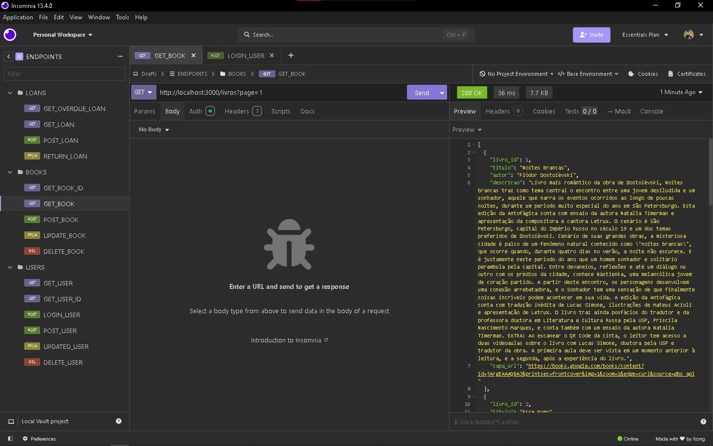


---

## 🗄️ Banco de dados

MySQL, com três tabelas:

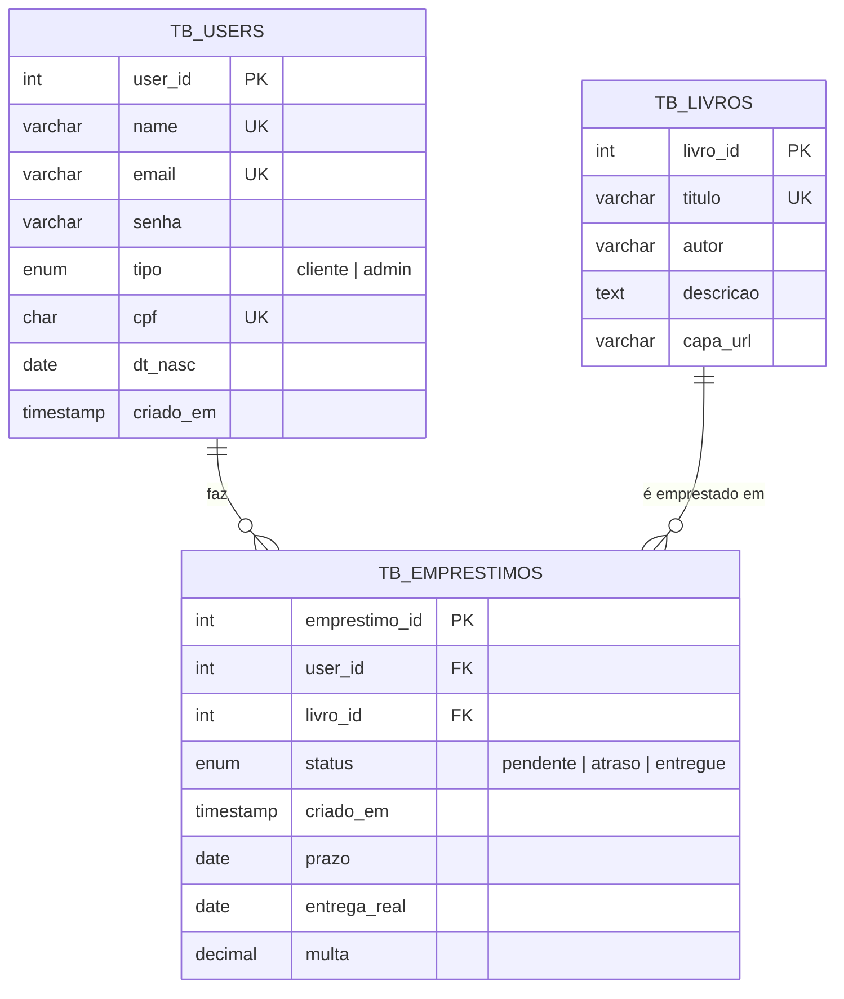

> A coluna `capa_url` deve ser `VARCHAR(500)`, porque as URLs de capa do Google Books podem passar de 150 caracteres.

**Prints do banco**

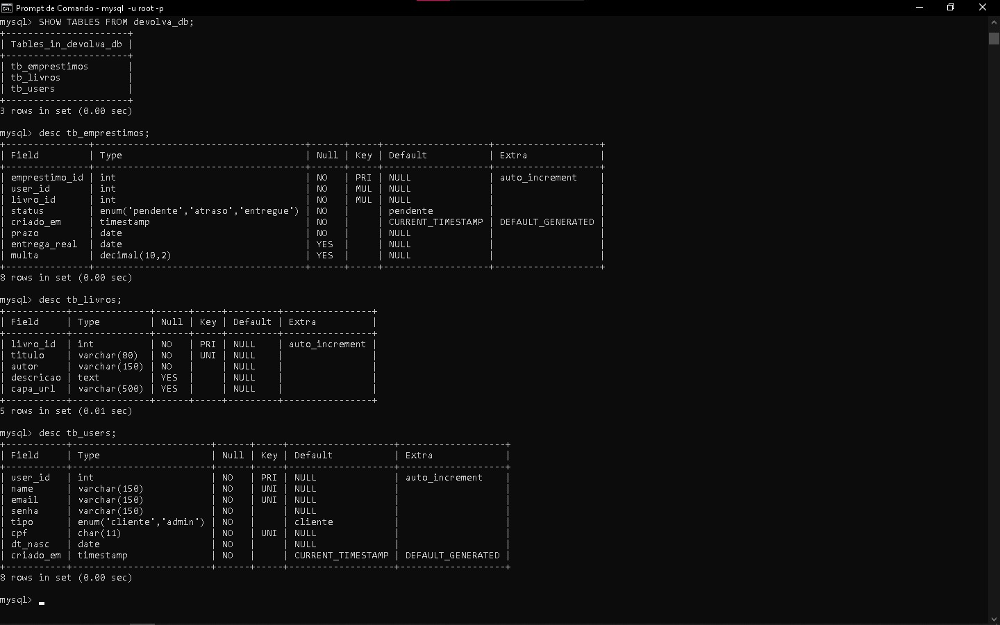

---

## 🗂️ Estrutura do projeto

```
devolva_app/
├── build.gradle
├── settings.gradle
└── app/
    ├── build.gradle
    └── src/main/
        ├── AndroidManifest.xml
        ├── java/com/exemplo/meuapp/
        │   ├── LoginActivity.java          # login e roteamento por tipo de usuário
        │   ├── AdminMainActivity.java      # casca do admin (abas)
        │   ├── ClientMainActivity.java     # casca do cliente (abas)
        │   ├── BookDetailActivity.java     # detalhes do livro
        │   ├── LoansFragment.java          # empréstimos + multas (admin e cliente)
        │   ├── BooksFragment.java          # catálogo (cliente) / gestão de livros (admin)
        │   ├── UsersFragment.java          # lista de usuários (admin)
        │   ├── ProfileFragment.java        # perfil e logout
        │   ├── *Adapter.java               # adapters das listas (RecyclerView)
        │   ├── ApiClient.java              # Retrofit + interceptor do JWT
        │   ├── ApiService.java             # rotas da API
        │   ├── Session.java                # token e dados do usuário logado
        │   ├── PagedLoader.java            # carrega todas as páginas da API
        │   ├── Capas.java                  # carrega capas com Glide
        │   └── (modelos) Emprestimo, Livro, Usuario, LoginRequest/Response, ...
        └── res/
            ├── layout/                     # telas, fragments e itens das listas
            ├── menu/                       # abas do admin e do cliente
            ├── drawable/                   # ícones e fundos
            └── values/                     # tema
```

---

## 🚀 Como executar

### Pré-requisitos
- [Android SDK](https://developer.android.com/studio) (compileSdk 34) e JDK 17
- Um celular Android com depuração USB ativada (ou um emulador)
- A **[API](https://github.com/SEU_USUARIO/NOME_DO_REPO_DA_API)** rodando, com o banco MySQL configurado

### 1. Suba a API
Siga o README do repositório da API e confirme que ela responde em `http://localhost:3000/`.

### 2. Configure o endereço da API no app
Edite `BASE_URL` em `app/src/main/java/com/exemplo/meuapp/ApiClient.java`:

| Onde você roda | Valor de `BASE_URL` |
|---|---|
| Celular real, no mesmo Wi-Fi do PC | `http://IP_DO_SEU_PC:3000/` (descubra com `ipconfig`) |
| Celular real por cabo USB | `http://localhost:3000/` e rode `adb reverse tcp:3000 tcp:3000` |
| Emulador do Android Studio | `http://10.0.2.2:3000/` |

> O app usa HTTP simples (`usesCleartextTraffic`) porque é um projeto de desenvolvimento. Em produção, use HTTPS.

### 3. Instale o app

```bash
# Windows (PowerShell)
./gradlew installDebug

# Linux / macOS
./gradlew installDebug
```

### 4. Entre com um usuário
- **Cliente:** cadastre um usuário pela rota `POST /usuarios` da API (o cadastro público sempre cria `cliente`).
- **Admin:** promova um usuário no banco:
  ```sql
  UPDATE tb_users SET tipo = 'admin' WHERE email = 'seu_email@exemplo.com';
  ```

---

## 🩺 Problemas comuns

| Sintoma | Causa provável e solução |
|---|---|
| `Device is UNAUTHORIZED` ao instalar | Desbloqueie o celular e aceite o popup **"Permitir depuração USB"**. Confira com `adb devices`. |
| "Não foi possível conectar à API" | API desligada, IP do PC mudou, firewall bloqueando a porta 3000 ou celular em outra rede. Teste `http://IP:3000/` no navegador do celular. |
| Volta para o login sozinho | O token expirou (validade de 1 dia). É o comportamento esperado: entre de novo. |
| Capas não aparecem | O livro não tem `capa_url` no banco, ou a busca no Google Books não encontrou o livro. Use **Editar** na tela de admin e cole uma URL de capa. |
| `AAPT: resource style/Theme.Devolva not found` | O arquivo `app/src/main/res/values/devolva_theme.xml` não está no lugar certo. |

---

## 👨‍💻 Autor

**Sandro Luan** — [@sandroluan](https://github.com/Sandroluan)

Projeto desenvolvido para a disciplina/curso **Programação mobile** — **UNICID**.
